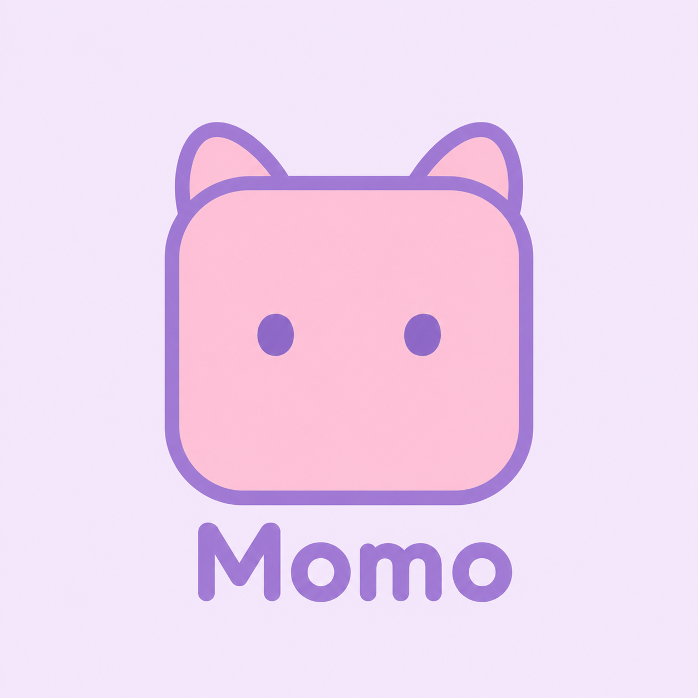
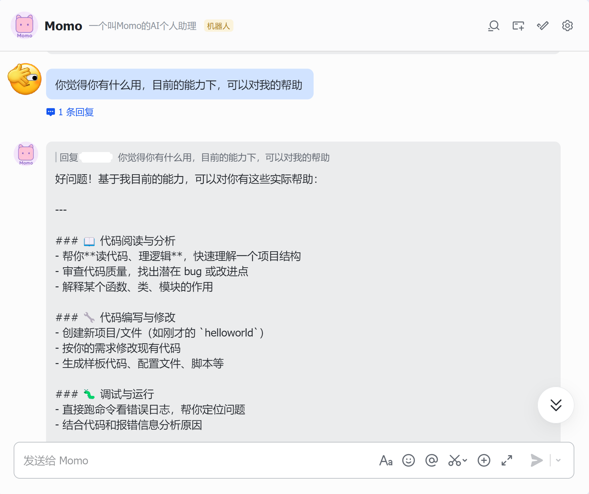

# MomoClaw - My Personal AI Coding Assistant

 **MomoClaw** is a Python coding-agent project with a unified AI provider layer,
agent loop, coding-agent session wrapper, IM bridge, and an MVP interactive CLI.

```
$ uv run momoclaw
MomoClaw CLI. Type /help for commands.
Model: deepseek/deepseek-v4-pro base_url=https://api.deepseek.com

> 你好
你好！我是 MomoClaw，你的编程助手。有什么我可以帮你的吗？

> 请告诉我 MomoClaw 的核心模块有几大部分？
让我先探索一下 MomoClaw 项目的结构，了解其核心模块。

  [tool] read /home/<user>/MomoClaw
    [ok] directory
  [tool] read /home/<user>/MomoClaw/momoclaw
    [ok] directory
  [tool] read /home/<user>/MomoClaw/pyproject.toml
    [ok] file
  [tool] read /home/<user>/MomoClaw/momoclaw/agent
    [ok] directory
  [tool] read /home/<user>/MomoClaw/momoclaw/ai
    [ok] directory
  [tool] read /home/<user>/MomoClaw/momoclaw/coding_agent
    [ok] directory
  [tool] read /home/<user>/MomoClaw/momoclaw/im
    [ok] directory

现在让我查看各模块的 README 和核心文件，以更深入了解每个模块的职责。

  [tool] read /home/<user>/MomoClaw/momoclaw/agent/README.md
    [ok] file
  [tool] read /home/<user>/MomoClaw/momoclaw/ai/README.md
    [ok] file
  [tool] read /home/<user>/MomoClaw/momoclaw/coding_agent/README.md
    [ok] file
  [tool] read /home/<user>/MomoClaw/momoclaw/im/README.md
    [ok] file

让我为您总结：

## MomoClaw 核心模块 — 4 大部分

1. momoclaw.ai — AI 层（AI Provider 抽象层）
   - 屏蔽不同 AI 厂商 API 协议差异
   - 提供统一消息模型、流事件协议和调度 API

2. momoclaw.agent — Agent 核心循环层
   - 执行用户输入 → 调用 AI → 执行工具 → 循环
   - 管理工具执行和事件广播

3. momoclaw.coding_agent — 编码 Agent 应用层
   - 提供编码专用 prompt、工作区工具和会话持久化
   - 支持可选的本地 Workspace Memory，按来源校验并检索项目事实
   - 内置工具：read、write、edit、bash

4. momoclaw.im — IM 即时通讯桥接层
   - 将飞书等 IM 平台事件桥接到 coding-agent 会话
   - 提供会话路由、服务编排和控制命令
```

## Run The CLI

```bash
uv run momoclaw
```

Useful options:

```bash
uv run momoclaw
uv run momoclaw --provider openai --model gpt-4.1-mini
uv run momoclaw --provider anthropic --model claude-sonnet-4-5
uv run momoclaw --provider deepseek --model deepseek-v4-pro
uv run momoclaw --provider openai --model gpt-4.1-mini --base-url https://gateway.example/v1
uv run momoclaw --workspace /path/to/project
uv run momoclaw --read-write
uv run momoclaw --memory
```

Set the matching API key before sending prompts:

```bash
export OPENAI_API_KEY=...
export ANTHROPIC_API_KEY=...
export DEEPSEEK_API_KEY=...
```

The default model is `deepseek/deepseek-v4-pro`, so `DEEPSEEK_API_KEY` is enough
for the default CLI path.

## CLI Commands

- `/help`: show commands.
- `/model`: show current provider/model/base URL.
- `/model list`: list built-in providers, models, and default base URLs.
- `/model set <provider> <model_id> [base_url]`: save model config and start a new session.
- `/model base-url <url|default>`: override or reset base URL for the current model.
- `/tools`: show enabled tools.
- `/usage`: show last model usage.
- `/memory`: inspect and manage workspace memory when memory is enabled.
- `/new`: start a new session with the current model.
- `/clear`: clear current in-memory conversation.
- `/exit`: exit.

The CLI stores model configuration, including optional `base_url`, under
`.momoclaw/config.json` in the selected workspace. Sessions are stored under
`.momoclaw/sessions/`.

By default the CLI starts in read-only mode and only exposes the `read` tool.
Use `--read-write` to enable `write`, `edit`, and `bash`. The CLI prints compact
tool call/result lines such as `[tool] read README.md` and `[tool:ok] read`.

## Agent Workspace Memory

Workspace Memory is an opt-in, local project knowledge store for facts and
working practices tied to files in the current workspace. Start the CLI with
`--memory`, then run `/memory init` to scan supported project files and create
a candidate overview. Review candidates with `/memory show <id>` and approve
only the entries you trust with `/memory approve <id>`. Retrieval uses lexical
matching and includes source paths; entries whose source files change are
marked stale and excluded. Memory is stored under `.momoclaw/memory/`, and the
feature does not send project files to a separate indexing service.

See [Workspace Memory documentation](docs/WORKSPACE_MEMORY.md) for commands,
storage format, scanning limits, and current limitations.

## Development

Run tests:

```bash
uv run pytest tests
```

Project planning and progress are tracked in `docs/DEVELOPMENT.md`.

## Contributing

欢迎通过 PR 为 MomoClaw 贡献改进。

Contributions are welcome. If you would like to improve MomoClaw, please open
an issue or pull request with a clear description of the change.

Before submitting a pull request, run the test suite:

```bash
uv run pytest tests
```

For larger changes, please discuss the approach first so the implementation can
fit the project's current architecture and roadmap.

## IM MVP

The IM bridge lives under `momoclaw/im/`. It includes normalized IM message
types, persistent channel/thread session routing, a platform-independent
`IMService`, an in-memory fake adapter for tests, and a Feishu adapter skeleton
for webhook parsing plus text replies.

Current IM control commands:

- `/help`
- `/new`
- `/clear`
- `/session`
- `/usage`

Reference doc: `momoclaw/im/README.md`.

### Feishu Long Connection



Install the optional Feishu long-connection dependency:

```bash
uv sync --extra feishu --extra dev
```

Run locally:

```bash
export FEISHU_APP_ID=...
export FEISHU_APP_SECRET=...
export DEEPSEEK_API_KEY=...

uv run --extra feishu momoclaw-feishu-longconn --workspace /home/wyc/MomoClaw
```

Useful options:

```bash
uv run --extra feishu momoclaw-feishu-longconn --card
uv run --extra feishu momoclaw-feishu-longconn --read-write
uv run --extra feishu momoclaw-feishu-longconn --metadata
uv run --extra feishu momoclaw-feishu-longconn --provider openai --model gpt-4.1-mini
uv run --extra feishu momoclaw-feishu-longconn --base-url https://gateway.example/v1
```

## License

MomoClaw is licensed under the MIT License. See [LICENSE](LICENSE) for details.
